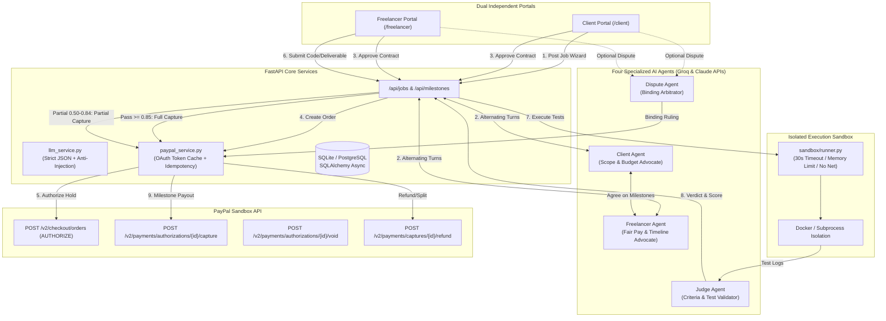

# TrustPay — Autonomous Escrow & Milestone Verification for AI-Negotiated Deals

[](https://devpost.com)
[](https://github.com/venmugilrajan/TrustPay)
[](https://opensource.org/licenses/MIT)
[](https://fastapi.tiangolo.com)
[](https://nextjs.org)

> **Two AI agents negotiate a freelance deal, PayPal holds the money in authorization escrow, and an AI Judge inspects the work in an isolated sandbox to release payments milestone by milestone.**

---

## 🎯 The Problem
Freelancers and students often don't get paid after completing work. Clients fear losing deposits to unverified developers. Traditional escrow platforms charge steep 10–20% fees and rely on slow human support tickets. 

**TrustPay** replaces counterparty risk with automated trust:
1. **Autonomous Negotiation**: Two AI agents formulate a structured contract with verifiable acceptance criteria.
2. **PayPal Authorization Escrow**: Funds are held via PayPal Orders v2 (`intent: AUTHORIZE`)—money is guaranteed without taking premature custody.
3. **Automated Code & Deliverable Verification**: An isolated Docker sandbox and AI Judge test submissions against acceptance criteria to drive automated full captures, partial payouts, or disputes.

---

## 🎨 Design & Experience
TrustPay features a calm, trustworthy fintech editorial aesthetic inspired by Stripe Climate, Wise, and Notion:
- **Palette**: Warm cream canvas (`#F6F0E4`), crisp paper-white cards (`#FFFDF8`), and deep woodland green primary actions (`#24493D`).
- **Typography**: Editorial serif (**Fraunces**) for titles and milestone amounts, clean sans-serif (**Inter**) for UI controls, and strict monospace (**JetBrains Mono**) strictly isolated to PayPal IDs and test runners.
- **Dual Dedicated Portals**:
  - **Client Portal (`/client/...`)**: Post a Job 3-step wizard, contract roadmap, PayPal escrow authorization, payment activity ledger, and dispute arbitration.
  - **Freelancer Portal (`/freelancer/...`)**: Available opportunities, actionable *"Next action needed"* banner, acceptance criteria checklist, drag-and-drop file uploader, AI Judge score ring, and earnings ledger.
  - **Role Selection Gateway (`/`)**: 3-step explanation with clean entry cards for clients and freelancers.
  - **Demo Hub (`/demo`)**: Standalone evaluator sandbox with 1-click seeding, reset controls, and live state metrics.

---

## 🏗️ Architecture



---

## ✨ Core Technical Highlights
- **Deterministic Contract Invariants**: Milestone amounts must sum strictly to `total_amount` (validated in Pydantic and database constraints).
- **Prompt-Injection Defense**: User deliverables are strictly isolated as passive data inside `<deliverable_data>`. Adversarial attempts to hijack the AI Judge are detected, flagged, and disqualified.
- **PayPal Orders v2 with Intent AUTHORIZE**:
  - `create_order_authorize`: Sets up authorization hold for agreed contract amount.
  - `authorize_order`: Captures PayPal authorization ID; funds held in escrow.
  - `capture_authorization`: Supports multiple partial captures and sets `final_capture: true` on final milestone.
  - `void_authorization`: Automatically voids holds if deadlines pass without delivery.
  - `refund_capture`: Returns disputed funds back to client.

---

## 🚀 Quickstart & Local Setup

### Prerequisites
- Python 3.11+
- Node.js 18+ and npm
- (Optional) Docker daemon for containerized sandbox execution

### 1. Clone & Configure Environment
```bash
git clone https://github.com/venmugilrajan/TrustPay.git
cd TrustPay
cp .env.example .env
```
Edit `.env` (TrustPay includes simulated sandbox fallbacks if keys are not yet configured):
```env
# AI Provider (Groq high-speed inference or Claude)
GROQ_API_KEY=your_groq_api_key
GROQ_MODEL=openai/gpt-oss-20b

# PayPal Developer Sandbox Credentials
PAYPAL_CLIENT_ID=your_paypal_sandbox_client_id
PAYPAL_CLIENT_SECRET=your_paypal_sandbox_client_secret
PAYPAL_BASE_URL=https://api-m.sandbox.paypal.com
```

### 2. Start Backend
```bash
# Install dependencies
python -m pip install -r backend/requirements.txt

# Run FastAPI server
uvicorn backend.main:app --port 8000
```
Backend API will be live at `http://localhost:8000`. Interactive docs at `http://localhost:8000/docs`.

### 3. Start Frontend
```bash
cd frontend
npm install
npm run build
npm start
```
Frontend will be live at `http://localhost:3000`.

---

## 💳 How Judges Can Test with PayPal Sandbox Accounts

1. **Role Selection & Demo Seeding**:
   - Open `http://localhost:3000`.
   - Choose **"I'm hiring (Client)"** or **"I'm a freelancer"**.
   - Or click **Demo Hub** in the header/footer to seed a pre-negotiated demo contract with 1 click.

2. **Live PayPal Sandbox Testing**:
   - Click **"Post a Job"**, fill in requirements, set budget, and launch negotiation.
   - Watch the Client Agent and Freelancer Agent agree on milestones.
   - Click **"Approve Contract"** as Client, and confirm as Freelancer.
   - Click **"Fund Escrow with PayPal"** — approve via the official PayPal JS SDK popup or click **Quick Sandbox Authorize**.
   - As the Freelancer, submit code/files in **My Work**. The AI Judge runs tests in the sandbox and releases payment via PayPal capture.

3. **Verify via PayPal Smoke Test Script**:
   ```bash
   # Runs Authorize -> Partial Capture ($40) -> Void ($60) against PayPal Sandbox
   python scripts/paypal_smoke_test.py
   ```

---

## 🧪 Testing Suite
TrustPay includes 22 automated tests covering contract invariants, PayPal operations, and agent prompt injection guardrails:
```bash
python -m pytest backend/tests/ -v
```

---

## 📦 Deployment (Render)
TrustPay is configured for Render via [`render.yaml`](file:///r:/Projects/paypal_project/render.yaml):
- **Backend**: Python web service running Uvicorn with SQLite/Postgres.
- **Frontend**: Node.js web service running Next.js 14 SSR/SSG.

---

## 📄 License
This project is licensed under the [MIT License](file:///r:/Projects/paypal_project/LICENSE).
