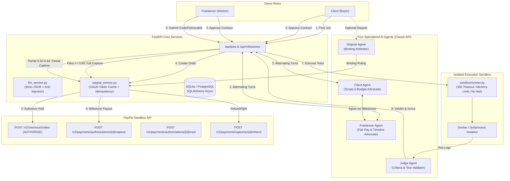

# TrustPay — Autonomous Escrow & Milestone Verification for AI-Negotiated Deals

[](https://devpost.com)
[](https://opensource.org/licenses/MIT)
[](https://fastapi.tiangolo.com)
[](https://nextjs.org)

> **Two AI agents negotiate a freelance deal, PayPal holds the money in authorization escrow, and an AI Judge inspects the work in an isolated sandbox to release payments milestone by milestone.**

---

## 🎯 The Problem
Freelancers and students often don't get paid after completing work. Clients fear losing deposits to unverified developers. Traditional escrow platforms charge steep 10–20% fees and rely on slow human support tickets. 

**TrustPay** replaces counterparty risk with automated trust:
1. **Autonomous Negotiation**: Two AI agents formulate a structured contract with verifiable acceptance criteria.
2. **PayPal Authorization Escrow**: Funds are held via PayPal Orders v2 (`intent: AUTHORIZE`)—money is guaranteed without taking premature custody.
3. **Automated Code & Deliverable Verification**: An isolated Docker sandbox and AI Judge test submissions against acceptance criteria to drive automated full captures, partial payouts, or disputes.

---

## 🏗️ Architecture



---

## ✨ Features
- **Deterministic Contract Invariants**: Milestone amounts must sum strictly to `total_amount` (validated with Pydantic in code).
- **Prompt-Injection Defense**: User deliverable payloads are treated strictly as passive data inside `<deliverable_data>`. Malicious instructions seeking score overrides are detected, flagged, and disqualified.
- **PayPal Orders v2 with Intent AUTHORIZE**:
  - `create_order_authorize`: Sets up authorization hold for agreed amount.
  - `authorize_order`: Captures PayPal authorization ID; funds held in escrow.
  - `capture_authorization`: Supports multiple partial captures and sets `final_capture: true` on completion.
  - `void_authorization`: Automatically voids holds if deadlines pass without delivery.
  - `refund_capture`: Returns disputed funds back to client.
- **Fintech UI with Role Switcher**:
  - Live agent dialogue transcript and interactive contract draft preview.
  - Milestone cards with per-criterion test evidence.
  - One-click role toggle between **Client** and **Freelancer** views.
  - **"Seed Demo Job" button**: Preloads 3 verified real-world scenarios (Pass, Partial, Fail/Dispute) with zero setup.

---

## 🚀 Quickstart & Local Setup

### Prerequisites
- Python 3.11+
- Node.js 18+ and npm
- (Optional) Docker daemon for containerized sandbox execution

### 1. Clone & Configure Environment
```bash
git clone https://github.com/your-username/trustpay.git
cd trustpay
cp .env.example .env
```
Edit `.env` (TrustPay includes simulated sandbox fallbacks if keys are not yet configured):
```env
ANTHROPIC_API_KEY=your_anthropic_api_key
PAYPAL_CLIENT_ID=your_paypal_sandbox_client_id
PAYPAL_CLIENT_SECRET=your_paypal_sandbox_client_secret
PAYPAL_BASE_URL=https://api-m.sandbox.paypal.com
```

### 2. Start Backend (Terminal 1)
```bash
# Install dependencies
python -m pip install -r backend/requirements.txt

# Run FastAPI server
uvicorn backend.main:app --reload --port 8000
```
Backend API will be live at `http://localhost:8000`. Interactive docs at `http://localhost:8000/docs`.

### 3. Start Frontend (Terminal 2)
```bash
cd frontend
npm install
npm run dev
```
Frontend will be live at `http://localhost:3000`.

---

## 💳 How Judges Can Test with PayPal Sandbox Accounts

1. **Dashboard & Demo Seeding**:
   - Open `http://localhost:3000/dashboard`.
   - Click **"Seed 3 Scenarios"** (or **"Seed Demo Job"** in the top navigation).
   - This immediately preloads:
     - **Scenario 1 (Pass)**: Zero-Knowledge Identity Module ($1,300.00). Score 0.96. Milestone 1 ($600.00) captured via PayPal.
     - **Scenario 2 (Partial)**: L2 Orderbook Matching Engine ($1,500.00). Score 0.72. Partial capture of $576.00 released with resubmission allowed.
     - **Scenario 3 (Fail & Dispute)**: Mempool Scanner ($1,800.00). Prompt injection detected, 0 payout, arbitrated by Dispute Agent ($360 capture / $540 refund).

2. **Live PayPal Sandbox Testing**:
   - In `.env`, provide your PayPal Sandbox App credentials from [developer.paypal.com](https://developer.paypal.com).
   - Click **"Post Job"**, fill in the title, and click **"Start AI Negotiation"**.
   - Click **"Auto-Run Deal"** to watch the Client Agent and Freelancer Agent negotiate terms.
   - Click **"Approve as Client"** and **"Approve as Freelancer"**.
   - Click **"Authorize with PayPal Sandbox"** — log in with your PayPal Sandbox Personal (Buyer) account.
   - Submit code in the Milestone view. The AI Judge tests the code in the sandbox and triggers the capture against your Sandbox Business (Seller) account.

3. **Verify via PayPal Smoke Test Script**:
   ```bash
   # Runs Authorize -> Partial Capture ($40) -> Void ($60)
   python scripts/paypal_smoke_test.py
   ```

---

## 🧪 Testing Suite
TrustPay includes comprehensive automated tests for contract invariants, PayPal operations, and agent security:
```bash
# Run full pytest suite
python -m pytest backend/tests/ -v
```

---

## 📦 Deployment (Render)
TrustPay is configured for Render via [`render.yaml`](file:///r:/Projects/paypal_project/render.yaml):
- **Backend**: Python web service running Uvicorn with SQLite/Postgres.
- **Frontend**: Node.js web service running Next.js 14 SSR/SSG.

---

## 📄 License
This project is licensed under the [MIT License](file:///r:/Projects/paypal_project/LICENSE).
