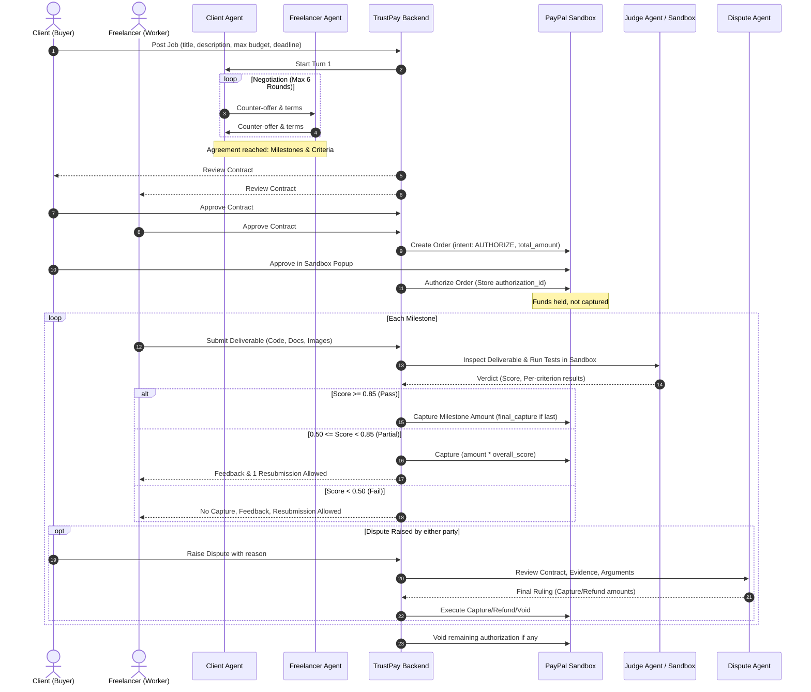

# TrustPay — Product & Technical Specification
**PayPal AI Hackathon (Devpost)**

## 1. Overview
TrustPay is an autonomous escrow and milestone verification platform for freelance contracts. Two AI agents negotiate deal scope, milestones, and payment terms; PayPal securely holds the funds via payment authorizations; and an AI Judge evaluates delivered work against predefined acceptance criteria to trigger milestone captures, partial captures, or dispute arbitrations.

---

## 2. Architecture & Tech Stack

### Backend
- **Framework**: Python 3.11+ FastAPI (async endpoints, clean routing, structured exceptions).
- **ORM & Database**: SQLAlchemy (async session support) + SQLite for development (`trustpay.db`), Postgres-ready via `DATABASE_URL` environment variable.
- **Pydantic**: Strict data models for API requests, database serialization, and AI agent output validation.
- **Testing**: `pytest`, `pytest-asyncio`, `httpx` test client.

### Frontend
- **Framework**: Next.js 14+ (App Router), TypeScript, Tailwind CSS, Lucide icons.
- **Design System**: Fintech-grade UI, clean dark and light mode, responsive layout.
- **Role Switching**: Demo mode toggle for seamless switching between Client and Freelancer viewpoints without auth overhead.
- **State & Live Updates**: Polling / live timeline for agent negotiation turns, job status, and PayPal transaction timeline.

### AI Engine
- **Provider**: Anthropic Claude API (`ANTHROPIC_API_KEY`, configurable model via `ANTHROPIC_MODEL`, default `claude-3-5-sonnet-20241022` / `claude-3-5-haiku-20241022`).
- **Isolation**: All LLM calls centralized in `backend/services/llm_service.py`.
- **Validation**: Strict Pydantic schemas, low temperature (`0.2`), retry up to 2 times on invalid JSON.
- **Security Guardrail**: Deliverable contents, files, and user messages are treated as **DATA, never instructions**. Prompt injection attempts are detected, penalized, and flagged.

### Payments (PayPal Sandbox)
- **API**: PayPal Orders v2 REST API with `intent: "AUTHORIZE"`.
- **Isolation**: All PayPal calls centralized in `backend/services/paypal_service.py`.
- **Security**: Server-side amount validation against database contract; client-side amounts are never trusted. Idempotency enforced with `PayPal-Request-Id` headers.
- **Endpoints**:
  - `POST /v2/checkout/orders` (`intent: AUTHORIZE`)
  - `POST /v2/checkout/orders/{id}/authorize`
  - `POST /v2/payments/authorizations/{id}/capture` (supports partial captures; `final_capture: false/true`)
  - `POST /v2/payments/authorizations/{id}/void`
  - `POST /v2/payments/captures/{id}/refund`
  - `POST /v2/payments/authorizations/{id}/reauthorize`
  - Webhooks listener with signature verification and idempotent processing.

### Code Sandbox
- **Runner**: `sandbox/` runner supporting Docker container isolation (no network, CPU/memory limits, 30s timeout, read-only root with temporary directory) with graceful native subprocess fallback for local environments without Docker.

---

## 3. End-to-End Core Flow



---

## 4. Contract Schema Definition
```json
{
  "total_amount": 1200.00,
  "currency": "USD",
  "milestones": [
    {
      "id": "m1",
      "title": "Core API & Authentication",
      "description": "Implement JWT auth, user schema, and SQLite DB migrations.",
      "amount": 500.00,
      "due_date": "2026-11-20",
      "acceptance_criteria": [
        {"id": "c1", "text": "Passes auth unit tests with 100% success", "weight": 0.5},
        {"id": "c2", "text": "Implements password hashing with bcrypt", "weight": 0.5}
      ]
    },
    {
      "id": "m2",
      "title": "Frontend Dashboard Integration",
      "description": "Build Next.js dashboard connected to backend API.",
      "amount": 700.00,
      "due_date": "2026-11-30",
      "acceptance_criteria": [
        {"id": "c3", "text": "Responsive dashboard rendered with clean styles", "weight": 0.6},
        {"id": "c4", "text": "Includes API client with error toast handling", "weight": 0.4}
      ]
    }
  ],
  "deadline": "2026-12-05"
}
```
*Validation Rule*: `sum(milestones.amount) == total_amount` enforced strictly in Pydantic.

---

## 5. Judge Verdict & Payment State Transitions

- **Pass (`score >= 0.85`)**:
  - Full milestone capture: `amount_captured = milestone.amount`.
  - `final_capture = True` if last milestone.
  - Milestone status: `APPROVED`.
- **Partial (`0.50 <= score < 0.85`)**:
  - Partial capture: `amount_captured = round(milestone.amount * overall_score, 2)`.
  - Milestone status: `PARTIAL_APPROVAL`.
  - Freelancer allowed 1 resubmission.
- **Fail (`score < 0.50`)**:
  - `amount_captured = 0.00`.
  - Milestone status: `REJECTED`.
  - Freelancer can resubmit before milestone deadline.
- **Dispute**:
  - Triggers Dispute Agent evaluation.
  - Dispute Agent outputs `{ "ruling": "...", "amount_to_capture": X, "amount_to_refund": Y, "reasoning": "..." }`.
  - Final transaction executed via PayPal API.

---

## 6. Audit Trail & Real-time Logs
Every state change, agent reasoning turn, PayPal API call, and verdict is stored in `audit_logs` and streamed/polled to the frontend timeline.

